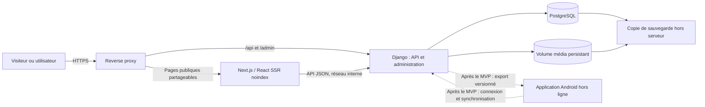

# Architecture

## Objectif

Décrire l'architecture proposée pour Découverte des Langues de France et rendre ses décisions structurantes consultables.

## Périmètre

Application neuve : MVP provençal uniquement, avec une cible de six territoires au total à terme. Les mini-jeux web responsives sont inclus au MVP ; l'application mobile native vient après. Le statut de chaque décision est indiqué dans son ADR. Les modèles sont dans [.github/templates](../../.github/templates/).

## Prérequis

- Lire le cahier des charges V2 et les décisions produit enregistrées dans la mémoire du projet.
- Tenir compte des choix du porteur : Python/Django, React/Next.js, PostgreSQL, Docker, exploitation auto-gérée et domaine `le-provencal.ovh`.

## Étapes

1. Examiner le schéma et les ADR.
2. Vérifier que tout changement structurant passe par un ADR.
3. Synchroniser les changements d'ADR et la mémoire avant l'implémentation.

## Schéma proposé

Le MVP provençal est un monolithe modulaire côté Django, accompagné d'un frontend Next.js rendu côté serveur pour les contenus publics partageables et les mini-jeux web responsives. Les pages sont `noindex` au MVP ; les aperçus sociaux sont générés côté serveur. Les données de compte sont chargées côté navigateur et ne sont pas mises en cache partagé. Les contenus publics en cache sont invalidés à chaque publication. Aucun client mobile natif n'est livré au MVP.

Django est la source de vérité des contenus ; les seeds historiques sont importés une fois comme brouillons. Les règles des jeux web sont versionnées avec le code et conçues pour pouvoir être portées ultérieurement vers une application mobile. Après le MVP, Android pourra embarquer un export versionné et synchroniser les résultats. Pas de microservices, Kubernetes, cache distribué ni moteur de recherche dédié au lancement.

## Contenu

- [ADR-001 — Backend Django modulaire](./adr/ADR-001-backend-django.md) : modèle applicatif et administration.
- [ADR-002 — Frontend React avec rendu serveur](./adr/ADR-002-frontend-react-ssr.md) : Next.js SSR, aperçus sociaux, `noindex`, URLs publiques et cache.
- [ADR-003 — PostgreSQL et recherche tolérante](./adr/ADR-003-postgresql-search.md) : données multi-territoires et recherche.
- [ADR-004 — Comptes, invitations et permissions](./adr/ADR-004-authentification.md) : rôles, liens manuels, données personnelles.
- [ADR-005 — Déploiement Docker et exploitation](./adr/ADR-005-deploiement.md) : local, OVH, sauvegardes et seuils de migration.
- [ADR-006 — Contenus canoniques et mini-jeux multiplateformes](./adr/ADR-006-contenus-et-jeux-multiplateformes.md) : import, jeux web du MVP et portage mobile ultérieur.
- [ADR-007 — Identité stable et mapping des seeds](./adr/ADR-007-identite-et-mapping-des-seeds.md) : slugs, import idempotent, brouillons.

Statuts au 2026-10-26 : ADR-001 à ADR-007 acceptés (PO délégué par le porteur ; révisables par le porteur).

Chaque décision structurante suit le [modèle ADR](../../.github/templates/adr-template.md) et reste à valider par le porteur du projet.

## Risques et réponses

| Risque | Réponse proposée |
|--------|------------------|
| Une permission territoriale mal appliquée expose ou altère le contenu d'un autre territoire. | Vérifier le territoire côté serveur sur chaque opération ; tester les accès inter-territoires avec des comptes distincts. |
| Les invitations et réinitialisations sont transmises manuellement. | Liens à usage unique, expiration 48 h (invitation) ou 1 h (réinitialisation), journalisation sans enregistrer le secret du lien. |
| (Post-MVP) Un jeton Android ou une file de résultats locale est exposé sur un appareil partagé. | Stockage sécurisé des jetons, identité déterminée côté serveur et suppression de la file à la déconnexion. |
| (Post-MVP) Un résultat Android en attente devient périmé après publication d'un contenu. | N'accepter que la version courante ; informer l'utilisateur et supprimer le résultat périmé de la file locale. |
| Une entrée historique incomplète est publiée ou jouée. | Importer les seeds comme brouillons ; publier seulement après enrichissement et validation éditoriale. |
| L'auto-hébergement fait peser les mises à jour et incidents sur une équipe réduite. | Images versionnées, vérifications de santé, sauvegardes quotidiennes hors serveur et test mensuel de restauration. |
| La recherche approximative ne couvre pas toutes les conventions d'écriture locales. | Conserver les variantes attestées, établir des jeux de tests par territoire et réévaluer si les mesures échouent. |
| Le seuil de 2 millions de visiteurs par jour pourrait retarder une évolution d'infrastructure. | Réévaluer aussi dès qu'une optimisation raisonnable ne permet plus de respecter l'objectif de réponse de 2 secondes sur OVH. |

## Vérification

**À préciser (post-MVP uniquement)** : cycle de vie des jetons Android (durée, renouvellement, révocation, stockage), dans un ADR dédié si l'application est engagée. Aucun paramètre ouvert ne bloque le MVP. En production, vérifier les métadonnées de partage et `noindex`, l'invalidation des caches à la publication, les accès territoriaux, les recherches dans les deux sens, les sauvegardes et la restauration mensuelle.

Chaque décision structurante du projet possède un ADR référencé ici.
