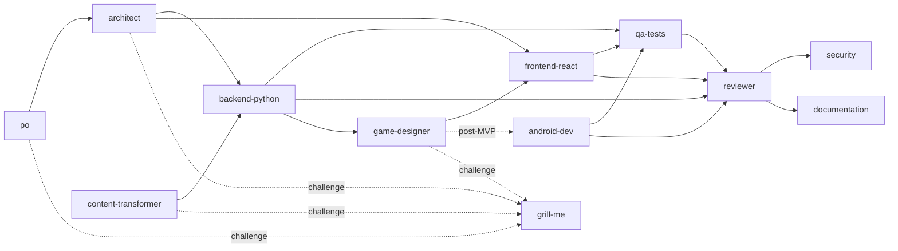

# Relations

## Objectif

Montrer comment agents, skills, prompts, modèles, standards et serveurs MCP s'articulent. C'est la seule page qui porte ces liens de façon synthétique ; le détail est dans la section « Voir aussi » de chaque fichier.

## Périmètre

Relations d'usage. L'inventaire est dans le [catalogue](./catalog.md), l'enchaînement dans le [workflow](./workflow.md).

## Lire les relations

| Relation | Sens | Où elle est déclarée |
|----------|------|----------------------|
| Prompt → agent | Le prompt active l'agent | `agent:` dans le frontmatter du prompt |
| Agent → skill | L'agent suit la procédure du skill | Section Procédure de l'agent |
| Agent → agent (handoff) | Bouton de passage de relais, validé par l'utilisateur | `handoffs:` dans le frontmatter |
| Agent → standard | L'agent applique les règles sans les redéfinir | Section Entrées de l'agent |
| Agent → modèle | L'agent remplit le modèle | Section Procédure de l'agent |
| Agent → MCP | Outils autorisés | `tools:` dans le frontmatter |
| Skill → skill | Renvoi vers une procédure voisine (hors périmètre) | Section Périmètre du skill |

## Agents

| Agent | Prompt d'entrée | Skills suivis | Modèle | Standards | MCP |
|-------|-----------------|---------------|--------|-----------|-----|
| po | define-project | — | user-story | documentation | memory |
| architect | design-architecture | architecture-review | adr | documentation, android (écart seulement) | context7, memory |
| backend-python | create-python-webapp | — | — | backend | context7, memory, postgres |
| frontend-react | create-react-feature | next-react-expert, design-system-accessibility | — | frontend, accessibility | context7, memory, playwright |
| qa-tests | test-change | — | — | backend, frontend, android | playwright, postgres, memory |
| reviewer | review-change | architecture-review | — | tous | memory |
| security | — (agent direct) | — | — | backend, android | context7, memory |
| documentation | document-change | documentation-excellence | documentation | documentation | memory |
| grill-me | — (agent direct) | grill-me | — | — | memory, context7 |
| content-transformer | transform-content | content-synthesis | learning-brief | game-content | playwright, context7, memory |
| game-designer | design-minigames | minigame-templates | game-spec | game-content, frontend, android post-MVP | memory |
| android-dev (post-MVP) | create-android-game | android-compose, design-system-accessibility | game-spec | android, game-content, accessibility | context7, memory |

« Tous » = backend, frontend, accessibility, android, game-content, documentation.

## Skills : qui les utilise

| Skill | Utilisé par | Prompt associé | Règles correspondantes |
|-------|-------------|----------------|------------------------|
| grill-me | agent grill-me ; tout agent avant un livrable critique | — | — |
| architecture-review | architect, reviewer | design-architecture | documentation (ADR) |
| next-react-expert | frontend-react | create-react-feature | frontend |
| design-system-accessibility | frontend-react, android-dev | — | frontend, accessibility, android |
| documentation-excellence | documentation | document-change | documentation |
| content-synthesis | content-transformer | transform-content | game-content |
| minigame-templates | game-designer | design-minigames | game-content, frontend, android |
| android-compose | android-dev | create-android-game | android |

## Prompts : quel agent, quelle suite

| Prompt | Agent | Livrable | Suite logique |
|--------|-------|----------|---------------|
| define-project | po | Backlog | design-architecture |
| design-architecture | architect | Schéma et ADR | create-python-webapp, create-react-feature |
| create-python-webapp | backend-python | Code, tests, note d'impact | test-change, review-change |
| create-react-feature | frontend-react | Code, tests, notes d'accessibilité | test-change, review-change |
| test-change | qa-tests | Tests et rapport | review-change |
| review-change | reviewer | Remarques classées, décision | document-change (ou agent security) |
| document-change | documentation | Docs et mémoire à jour | Fin du cycle |
| transform-content | content-transformer | Brief et pack candidat | préparation de l'import dans Django |
| design-minigames | game-designer | Spécification des jeux web du MVP | create-react-feature ; create-android-game après le MVP |
| create-android-game | android-dev | Application Android post-MVP | test-change, review-change |

## Enchaînements (handoffs)

Les agents `security` et `grill-me` n'ont pas de prompt : on les choisit dans la liste des agents.

## Maintenir cette page

Toute création, suppression ou modification d'un agent, skill, prompt, modèle ou standard met à jour cette page dans la même itération. Règle complète : [standard documentaire](../standards/documentation.md).

## Vérification

`python scripts/lint_pack.py` contrôle que chaque `handoff` et chaque lien pointe vers un élément existant. La cohérence des tableaux ci-dessus avec les fichiers est vérifiée à la relecture.

## Voir aussi

- [Guide d'utilisation](../guides/utilisation.md)
